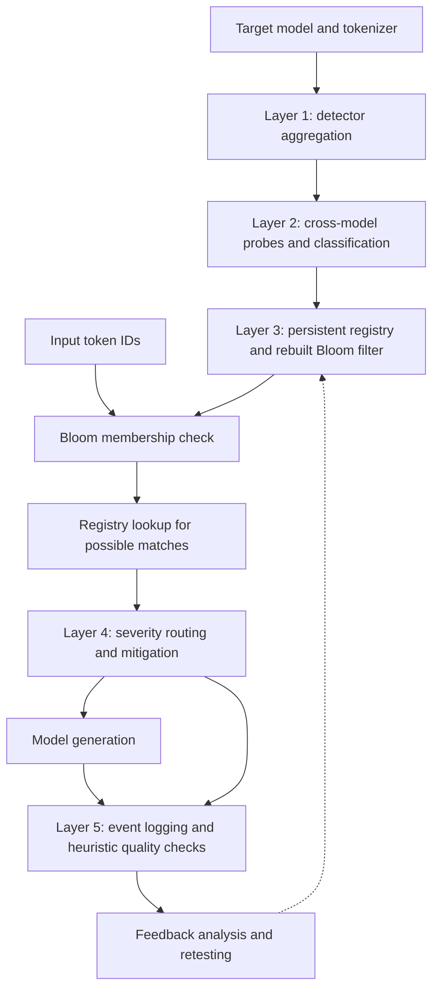

# HMUTTMS: Hybrid Multi-Layer Under-Trained Token Mitigation System

**Author and project implementation:** Muftasim Fuad Mahee  
**Status:** Research prototype with initial testing; corrected evaluation and broader effectiveness assessment remain pending.

HMUTTMS investigates whether token-level detection can support useful interventions during language-model inference. It connects existing under-trained-token detectors to cross-model probing, a persistent registry, four mitigation tracks, and an event-based feedback mechanism.

The central research question is whether these interventions improve task performance **while preserving the information carried by the original input**. Successfully replacing a token or constructing an embedding is an implementation outcome; establishing that the intervention repairs model behavior requires a separate evaluation.

## Research motivation

Some vocabulary entries exhibit unreliable behavior under token-reproduction or related probes. A detection result identifies a candidate for investigation, but does not by itself establish the cause of the failure or its consequences in realistic tasks. HMUTTMS explores the next step: deciding when to intervene, selecting an intervention, and recording what happened.

The project examines three questions:

1. How can results from different detectors and a second model be combined into an inspectable classification process?
2. Can a persistent registry separate expensive offline analysis from runtime handling?
3. Which interventions preserve task-relevant information, and what costs or regressions do they introduce?

This repository provides the implementation and an initial experimental basis for those questions. It does not establish a general mitigation benefit or a claim of priority over all previous work.

## Architecture



Unflagged tokens pass through without mitigation. A Bloom-filter match is provisional and is followed by a registry lookup.

| Layer | Responsibility | Implementation |
|---|---|---|
| 1. Detection | Wrap Magikarp and GlitchMiner and aggregate candidate records | [`layer1_detection`](src/hmuttms/layer1_detection/) |
| 2. Validation | Probe candidate strings using a reference model or cached results; classify each candidate | [`layer2_validation`](src/hmuttms/layer2_validation/) |
| 3. Registry | Persist classifications, replacement information, metadata, and fallback rules; rebuild the runtime Bloom filter | [`layer3_registry`](src/hmuttms/layer3_registry/) |
| 4. Mitigation | Route flagged tokens through applicable intervention tracks and record their outcomes | [`layer4_mitigation`](src/hmuttms/layer4_mitigation/) |
| 5. Feedback | Log events, calculate heuristic output scores, and support escalation and retesting | [`layer5_feedback`](src/hmuttms/layer5_feedback/) |

The registry supports a RocksDB-backed implementation through `rocksdict` and a JSON-directory backend. In `auto` mode, unavailable native storage can cause a fallback to JSON. Experiments should select and record the backend explicitly.

### Candidate classification

The current defaults in [`DecisionConfig`](src/hmuttms/layer2_validation/decision_matrix.py) are:

| Target-model score A | Reference-model score B | Classification |
|---|---|---|
| A < 0.30 | B < 0.50 | `BLACKLIST` |
| A < 0.30 | B > 0.60 | `SUBSTITUTABLE` |
| A >= 0.30 | B > 0.60 | `FALSE_POSITIVE` |
| Other combinations, including missing B results | | `REVIEW` |

These names describe decisions under the configured probes and thresholds. They are not independently established ground truth about training exposure. The two models' scores also come from different procedures and should not be treated as calibrated probabilities on a common scale. A larger reference model is not an oracle.

### Runtime mitigation tracks

| Track | Mechanism | Evidence from the initial runtime notes |
|---|---|---|
| 1. Token substitution | Replace a token with a stored replacement sequence when available | No recorded attempts |
| 2. Activation repair | Stage MLP activation patches for application during generation | No recorded attempts |
| 3. Embedding injection | Use a stored fallback embedding or construct a distance-weighted mean of surrounding target-model token embeddings | Eight reported successful operations using the neighboring-token fallback |
| 4. Hard blocking | Use a fallback token, remove the token when no fallback exists, or raise an error in explicit rejection mode | No recorded attempts |

Track numbering follows the source filenames. The context-based intervention is **Track 3**, not Track 1. In the initial tests, the reference model supplied cross-validation evidence; it did not supply the replacement embeddings used by this track.

The pipeline stops at the first track reporting operational success. For embedding injection, `success=True` records construction and staging of a patch; it is not an independent judgment of the generated answer. Preserving a token's position does not guarantee preserving its meaning. Hard blocking likewise does not guarantee a safe or correct response.

## Implementation and personal contribution

I developed HMUTTMS as an individual implementation project alongside my undergraduate work on tokenization and under-trained tokens. My contribution is the integration of detector outputs with cross-model classification, persistent storage, runtime routing, inference hooks, feedback logging, and evaluation tooling in `src/hmuttms/`.

I also conducted initial testing, investigated inconsistent evaluation artifacts, and revised the validation threshold to reflect the discrete probe scores. These steps produced an inspectable research pipeline and identified issues that must be addressed before drawing effectiveness conclusions.

The project builds on existing research and software. Magikarp and GlitchMiner provide upstream detection components; activation repair draws on GlitchProber. Those methods, their original implementations, and pre-collected upstream data are not presented as my original contributions. The scope of this project is their integration with the HMUTTMS pipeline and the investigation of its behavior.

## Initial experimental status

The [first-run project notes](https://docs.google.com/document/d/1l5_AoTypne2BialXow6xIQ0NdDVoBseW7wpJX4OJyAc/edit?tab=t.kff3jhdnw1yz) describe Qwen2.5-7B-Instruct as the target and Qwen2.5-14B-Instruct as the reference model.

| Recorded observation | Interpretation |
|---|---|
| 2,979 candidate tokens in a vocabulary of 152,064 entries | Candidate count under the initial detection procedure, not a verified prevalence estimate |
| Eight Track 3 operations reported success | Limited evidence that the neighboring-token embedding path executed; not eight independently verified semantic repairs |
| 20 of 21 runtime outputs passed the quality checker | A heuristic pass count based on length, repetition, and character diversity; not task accuracy |
| No recorded attempts for Tracks 1, 2, or 4 | Their effectiveness was not evaluated in that runtime sample |

These observations are reported from development notes, not a corrected benchmark release. The notes mix results and proposed follow-up actions, and their accounts of substitution counts and threshold changes are not fully consistent. Classification totals and latency claims should therefore be regenerated from one versioned run before being used as headline results.

### Issues identified during testing

**Bloom-filter artifact mismatch.** The notes report that evaluation loaded an older filter containing all detection candidates, while the rebuilt registry-based filter was saved elsewhere. A corrected evaluation must use the same registry and rebuilt filter as the runtime pipeline. A path correction alone does not establish zero false positives.

**Discrete validation scores.** The three-probe reference-model score takes values of 0, 1/3, 2/3, or 1. Lowering the pass threshold from 0.70 to 0.60 admits the two-of-three category. This is an evaluation-policy change requiring regenerated classifications and comparison with the earlier setting. It does not guarantee that substitution becomes applicable: replacement data and routing conditions still matter. The executable defaults use 0.60, while some historical descriptions retain 0.70.

**Limited quality measurement.** The built-in quality checker measures simple surface properties. It cannot establish factual correctness, semantic equivalence, preservation of identifiers, or successful task completion. The next evaluation must score those outcomes directly.

## Repository organization

```text
.
|-- src/
|   |-- hmuttms/
|   |   |-- layer1_detection/
|   |   |-- layer2_validation/
|   |   |-- layer3_registry/
|   |   |-- layer4_mitigation/
|   |   |-- layer5_feedback/
|   |   |-- inference/
|   |   |-- evaluation/
|   |   `-- run_full_pipeline.py
|   `-- run_magikarp_tests.py
|-- magikarp_lib/
|-- glitchminer_lib/
|-- data/
|-- pyproject.toml
`-- requirements.txt
```

`data/` includes pre-collected detector material and cached results. Its contents should not be assumed to belong to the Qwen first run or to share a tokenizer. Cached records must be checked against the target model, tokenizer, and probe procedure before reuse.

## Setup and execution

The project targets Python 3.11 or 3.12. The examples below use PowerShell from the repository root. Full model runs require sufficient memory for the selected models; resource requirements depend on loading settings. These commands follow the repository interfaces and are not a claim of a newly reproduced run.

```powershell
git clone https://github.com/fuad-mahee/Hybrid-Multi-Layer-Under-Trained-Token-Mitigation-System.git
Set-Location Hybrid-Multi-Layer-Under-Trained-Token-Mitigation-System
py -3.11 -m venv .venv
.\.venv\Scripts\Activate.ps1
python -m pip install --upgrade pip
```

Install a PyTorch build appropriate for the machine using the [official installation instructions](https://pytorch.org/get-started/locally/), then install the project dependencies and local detector packages:

```powershell
python -m pip install -r requirements.txt
python -m pip install -e ./magikarp_lib
python -m pip install -e ./glitchminer_lib
$env:PYTHONPATH = (Resolve-Path ./src).Path
```

To use the RocksDB backend, install `rocksdict` and select `--backend rocksdict`. The examples use `jsondir` explicitly for portable inspection; they do not reproduce RocksDB performance measurements.

### 1. Offline detection, validation, and registry construction

Choose a new run directory so that existing results are preserved. Use the same paths in every subsequent command.

```powershell
python -m hmuttms.run_full_pipeline offline --model-id Qwen/Qwen2.5-7B-Instruct --hf-model-b Qwen/Qwen2.5-14B-Instruct --device cuda --backend jsondir --l1-output data/runs/qwen_recheck/layer1_candidates.jsonl --l2-output data/runs/qwen_recheck/layer2_classified.jsonl --registry-root data/runs/qwen_recheck/registry --bloom-output data/runs/qwen_recheck/bloom_filter.bin --progress
```

The offline command launches the layer-specific programs. Model-loading behavior is controlled within those detector and validation modules; inspect their settings when adapting to different hardware. Use `--help` on each entry point to inspect supported arguments.

### 2. Interactive runtime inspection

```powershell
python -m hmuttms.run_full_pipeline runtime --model-id Qwen/Qwen2.5-7B-Instruct --device cuda --dtype float16 --backend jsondir --registry-root data/runs/qwen_recheck/registry --bloom-output data/runs/qwen_recheck/bloom_filter.bin --event-log data/runs/qwen_recheck/events.jsonl --verbose
```

Inspect the audit records as well as the generated text. For embedding injection, check whether the source is `neighbor_weighted_mean` or `fallback_embedding`. Record prompts and unmodified-model outputs separately for a meaningful comparison.

### 3. Summarize runtime events

```powershell
python -m hmuttms.evaluation.run_eval mitigate --event-log data/runs/qwen_recheck/events.jsonl --model-a-id Qwen/Qwen2.5-7B-Instruct --model-b-id Qwen/Qwen2.5-14B-Instruct --report-out data/runs/qwen_recheck/mitigation_report.json
```

The evaluation module also exposes `detect`, `latency`, and `full` subcommands. Event-log summaries report the existing operational and heuristic measures; they do not independently validate repairs. Using Layer 2's own labels as detection ground truth measures agreement with that procedure, not independently verified detection accuracy.

## Evaluation plan

A corrected study should first freeze the code revision, model and tokenizer revisions, thresholds, prompts, generation settings, storage backend, and artifact paths. It should then:

1. Regenerate classifications, the registry, and the Bloom filter together, retaining the original run for comparison.
2. Establish probe and task labels independently of the pipeline's own classifications, with explicit handling of ambiguous cases.
3. Compare the unmodified model with individual tracks and the routed pipeline on the same inputs, including ordinary-token controls.
4. Score exact-string preservation, task correctness, and meaning preservation alongside operational success and heuristic output quality.
5. Report track coverage, unsuccessful attempts, regressions, and uncertainty. Separate lookup microbenchmarks from complete generation latency.
6. Repeat across seeds and model configurations, separating development cases from final evaluation cases.

Cross-model embedding transfer remains a separate research question: equal vector dimensions alone do not establish alignment between models' embedding spaces. The initial neighboring-token fallback should not be described as validated transfer from the reference model.

## References and attribution

- **Magikarp:** [Fishing for Magikarp: Automatically Detecting Under-trained Tokens in Large Language Models](https://aclanthology.org/2024.emnlp-main.649/); see the included [`magikarp_lib`](magikarp_lib/) documentation and attribution.
- **GlitchMiner:** [upstream repository](https://github.com/wooozihui/GlitchMiner); see [`glitchminer_lib`](glitchminer_lib/).
- **GlitchProber:** activation-repair research referenced in the project's included [paper](Glithcprober.pdf) and Track 2 implementation.
- **Design history:** [proposed flowchart](Proposed%20flowchart.pdf). Numerical targets in the proposal are hypotheses, not measured improvements.

Retain the licenses and attribution supplied with upstream components. This README does not assign a new license to the repository or to third-party software and data.
